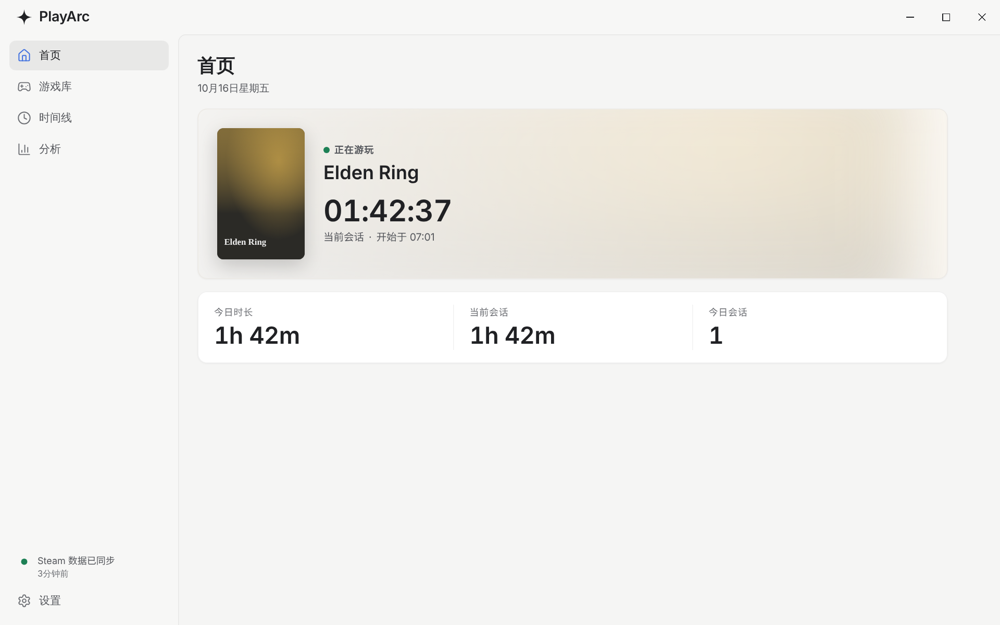
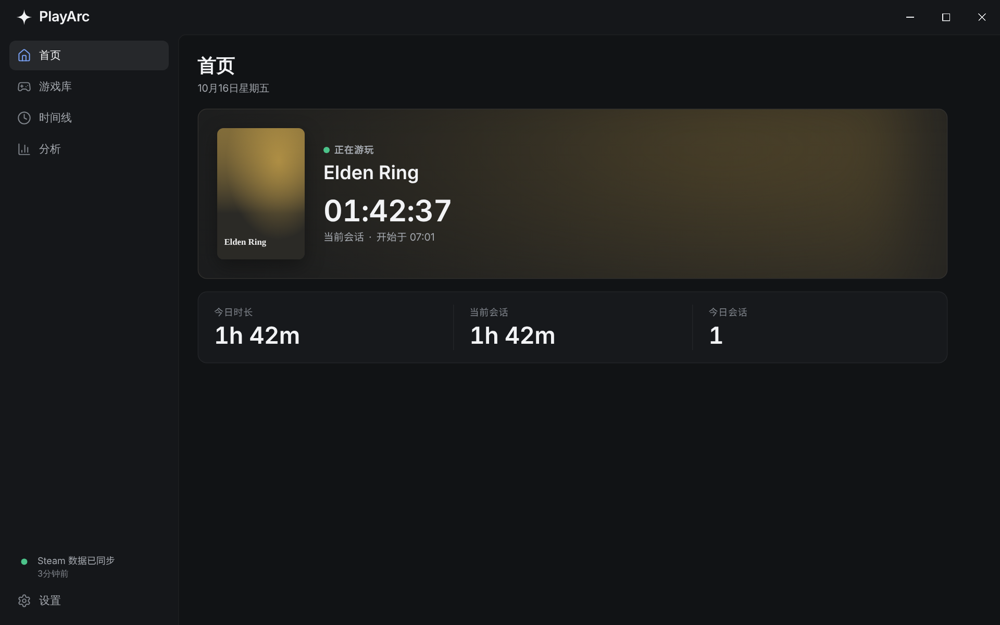
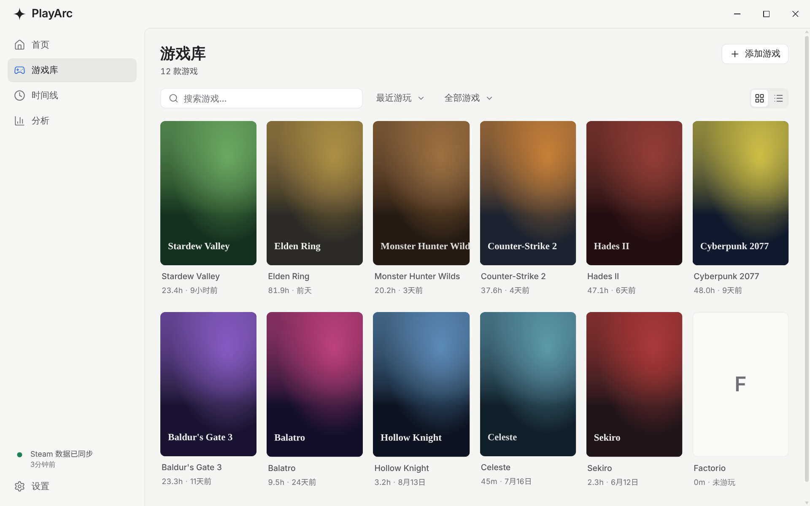
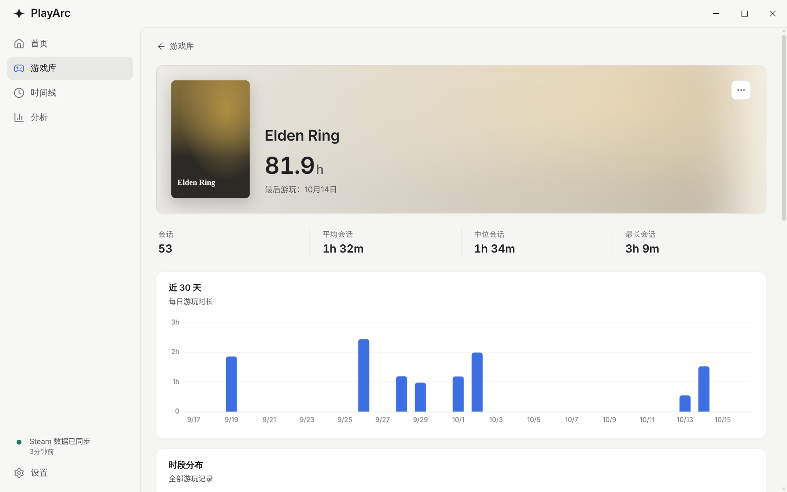
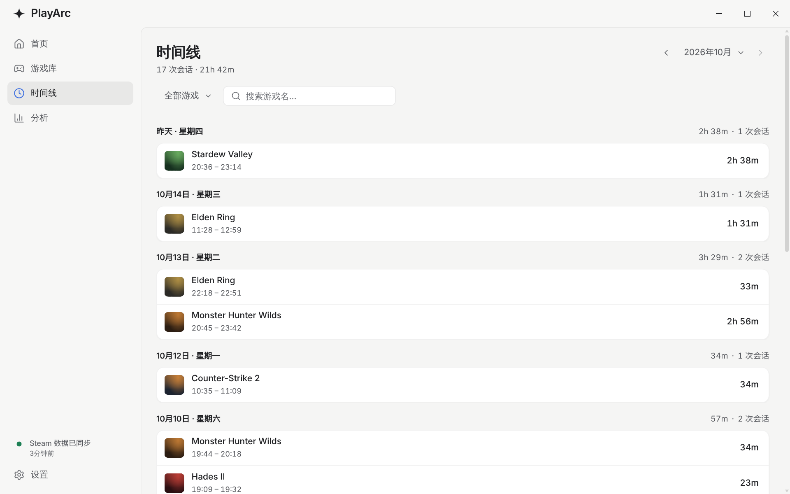
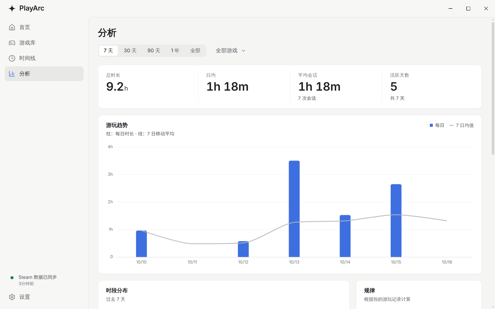
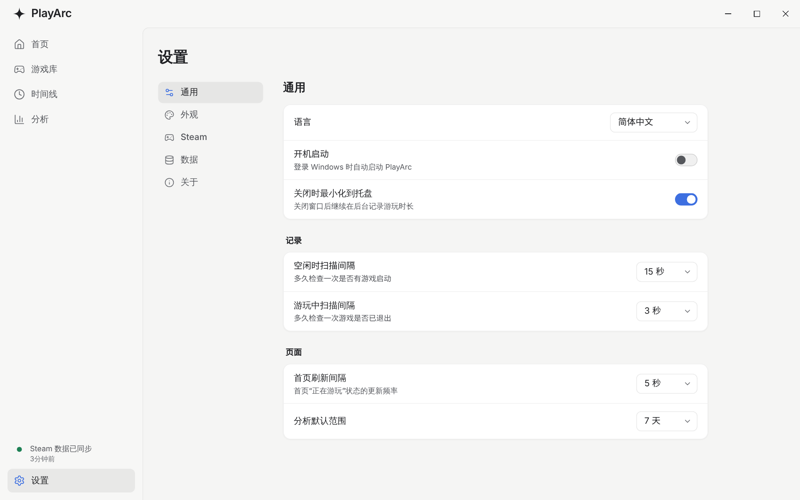

<p align="center">
  
</p>

<h1 align="center">PlayArc</h1>

<p align="center">
  一个面向 Windows 桌面端的本地游戏时长追踪工具。自动识别游戏、记录每一次游玩，并用首页、时间线和分析视图展示你的游戏习惯。所有数据只保存在本机。
</p>

<p align="center">
  <a href="https://github.com/K1nesss/PlayArc/releases/latest">
    
  </a>
  
  
  
  
</p>

<p align="center">
  <a href="#功能概览">功能</a>
  ·
  <a href="#界面预览">预览</a>
  ·
  <a href="#安装">安装</a>
  ·
  <a href="#首次配置">首次配置</a>
  ·
  <a href="#使用教程">教程</a>
  ·
  <a href="#常见问题">常见问题</a>
  ·
  <a href="#开发">开发</a>
</p>

## 功能概览

- **自动记录**：后台监听游戏进程，自动记录每次游玩的开始、结束和时长；关闭窗口后可继续在托盘中记录。
- **首页**：正在游玩的游戏与本次时长、最近游玩、今日时长，一眼看清当前状态。
- **游戏库**：Steam 已安装游戏自动出现，支持手动添加非 Steam 游戏、搜索、排序、只看已安装，以及网格 / 列表两种视图。
- **游戏详情**：总时长、会话统计（平均 / 中位 / 最长）、近 30 天趋势、常玩时段和完整游玩记录。
- **时间线**：按月、按天浏览每一次游玩会话，跨午夜的会话会正确拆分到每一天。
- **分析**：7 天 / 30 天 / 90 天 / 1 年 / 全部区间，含游玩趋势、时段分布、活跃热力图、游戏排行和会话时长分布。
- **Steam 同步**：同步游戏图标、封面和详情页背景图，可在后台定期自动同步。
- **外观**：浅色 / 深色主题，Windows 11 上支持原生 Mica 材质，界面支持中文和英文。
- **本地数据**：数据库与图片缓存只保存在本机，支持数据导入导出。
- **开机启动与托盘**：可随 Windows 启动并直接进入托盘。左键点击托盘图标打开主窗口；右键菜单可显示主窗口、同步 Steam、切换开机启动、打开设置或退出（菜单样式可在设置中切换为系统菜单）。
- **应用内更新**：发现新版本时提醒，一键更新。

## 界面预览

### 首页



### 深色主题



### 游戏库



### 游戏详情



### 时间线



### 分析



### 设置



## 安装

最新安装包在 GitHub Releases：

```text
https://github.com/K1nesss/PlayArc/releases/latest
```

Windows 用户下载 `PlayArc_<版本号>_x64-setup.exe` 并运行即可。首次启动时，如果系统提示安全确认，请确认安装包来自本仓库的 Release。

### 从 Velaris 升级

PlayArc 是 Velaris 的新名字。首次启动 PlayArc 时，会自动把 Velaris 的数据库和设置复制到新的数据目录，原有数据不会被修改或删除。由于应用名称变化，Windows 可能会把 PlayArc 安装为一个新程序；确认数据正常后，可以在“设置 › 应用”中卸载旧的 Velaris。

## 首次配置

PlayArc 不需要任何配置就能记录游戏时长。如果想同步 Steam 游戏的图标、封面和详情页背景图，需要在 **设置 › Steam** 中填写 Steam Web API Key 和 Steam64 ID。

### 获取 Steam API Key

1. 打开 [Steam Web API Key 页面](https://steamcommunity.com/dev/apikey) 并登录 Steam 账号。
2. 按页面提示申请或查看 API Key。如果要求填写 Domain Name，个人本地使用可以填写 `localhost`。
3. 复制生成的 32 位 API Key。

注意：

- API Key 是访问你 Steam Web API 数据的凭证，不要公开分享，也不要提交到 GitHub、论坛、截图或日志中。
- 如果怀疑泄露，回到 Steam Web API Key 页面撤销并重新生成。
- 使用 Steam Web API 需要同意 Steam API Terms of Use。

### 获取 Steam64 ID

Steam64 ID 是以 `7656119` 开头的 17 位数字，例如 `76561198000000000`。

1. 打开 Steam 个人资料页，复制个人资料链接。
2. 如果链接形如 `https://steamcommunity.com/profiles/76561198000000000`，末尾数字就是 Steam64 ID。
3. 如果链接形如 `https://steamcommunity.com/id/yourname`（自定义 URL），可以用 [SteamID I/O](https://steamid.io/lookup/) 转换成 Steam64 ID。

### 在 PlayArc 中填写

1. 打开 **设置 › Steam**。
2. 填入 Steam Web API Key 和 Steam ID，输入格式不对时会直接提示。
3. 点击“同步”，或开启“自动同步”让 PlayArc 在后台定期同步。

侧边栏底部会显示 Steam 同步状态，点击即可立即同步（快捷键 `Ctrl+R`）。

## 使用教程

### 首页

首页展示当前状态：正在游玩的游戏和本次已玩时长、最近一次游玩、今日游玩时长。启动任意已识别的游戏，PlayArc 会自动开始记录。

### 游戏库

- Steam 扫描到的已安装游戏会自动出现；有 Steam 封面时优先显示封面。
- 支持按名称搜索，按最近游玩 / 游玩时长 / 会话数 / 名称排序，以及只显示已安装的游戏。
- 右上角可以在网格和列表视图之间切换。
- 点击游戏进入详情页。

### 手动添加游戏

如果游戏不是 Steam 游戏，或没有被自动扫描到：

1. 在游戏库页面点击“添加游戏”。
2. 选择游戏的 exe 文件，PlayArc 会自动填写名称并提取图标。
3. 按需修改名称，选择封面和背景图。
4. 保存后，PlayArc 会在该程序运行时记录时长。

建议选择真正运行游戏的 exe，而不是启动器、更新器或卸载程序，这样识别更准确。

### 游戏详情

详情页展示总时长、会话次数、平均 / 中位 / 最长会话、近 30 天趋势、常玩时段和最近的游玩记录。右上角菜单可以隐藏或删除游戏；删除单条记录前会二次确认，进行中的会话不能删除。

### 时间线

时间线按月份浏览所有游玩会话，并按天分组显示当天的总时长和会话数。支持按游戏筛选和搜索；从游戏详情页的“在时间线中查看”进入时会自动筛选该游戏。

### 分析

分析页可以选择时间区间（7 天 / 30 天 / 90 天 / 1 年 / 全部）并筛选单个游戏，包含：

- 关键指标：总时长、日均、平均会话、活跃天数。
- 游玩趋势：每日时长与 7 日移动平均。
- 时段分布：一周中每天每小时的游玩热力图。
- 活跃热力图、游戏排行和会话时长分布。

默认区间可以在 **设置 › 通用** 中调整。

### 隐藏和删除游戏

- **隐藏**：从游戏库中隐藏但保留数据，适合 Steam 工具、Dedicated Server 等不想展示的条目。
- **删除**：移除游戏条目，操作前会确认。

已隐藏的游戏可以在 **设置 › 数据** 中恢复；被忽略的 Steam 项目可以在 **设置 › Steam** 中恢复。

### 设置

- **通用**：语言、开机启动、关闭时最小化到托盘、托盘菜单样式、扫描间隔、首页刷新间隔、分析默认区间。
- **外观**：主题模式、动效、侧边栏透明效果（Windows 11 Mica）、紧凑游戏列表。
- **Steam**：API Key、Steam ID、立即同步、自动同步及间隔、重新下载全部图片、已忽略项目。
- **数据**：导入 / 导出数据、已隐藏游戏、打开日志文件、清除游玩记录、恢复默认设置。
- **关于**：版本信息与检查更新。

设置修改后会自动保存，不需要额外点击保存。

### 快捷键

| 快捷键          | 作用                                                     |
| --------------- | -------------------------------------------------------- |
| `Ctrl+K`        | 打开命令面板（跳转页面、搜索游戏、同步 Steam、切换主题） |
| `Ctrl+B`        | 展开 / 收起侧边栏（也可以点击左上角的星形图标）          |
| `Ctrl+R` / `F5` | 刷新当前页面并同步 Steam 数据                            |
| `Ctrl+,`        | 打开设置                                                 |
| `Esc`           | 关闭弹窗和菜单                                           |

### 数据和缓存

PlayArc 在本地保存以下数据：

- SQLite 数据库、设置和窗口状态：`%LOCALAPPDATA%\PlayArc\`
- Steam 图标、封面、背景图以及手动添加游戏的图片缓存

这些数据只保存在本机。Steam API Key 只用于在本机请求 Steam API。

## 常见问题

### 为什么游戏库没有显示 Steam 游戏？

- Steam 未安装、游戏未安装，或 Steam 库路径暂时没有被扫描到。
- 游戏已被隐藏（可在 **设置 › 数据** 中恢复）。

可以尝试重启 PlayArc。

### Steam 同步失败怎么办？

同步失败时，设置页会直接显示具体原因：

- **“Steam rejected the API key”**：API Key 无效或已撤销，请重新生成并填写。
- **“Failed to reach Steam: could not connect / timed out”**：当前网络无法访问 `api.steampowered.com`。在部分地区该接口不稳定，可以开启网络加速后重试。
- **证书相关错误**：PlayArc 信任系统证书库，Watt Toolkit 等通过本地证书代理 Steam 的加速工具可以正常使用；如果仍然报错，请确认加速工具的证书已安装。

也请确认 Steam 个人资料和游戏详情为公开状态。对于不存在的图片（工具、服务器、运行库等），PlayArc 会记录失败结果，避免反复请求。

### 为什么某些游戏记录不到时长？

- 手动添加时选择的不是实际运行的 exe。
- 游戏通过启动器拉起了另一个真正的游戏进程。
- 游戏启动和退出太快，没有被扫描到（可以在设置中缩短扫描间隔）。

### API Key 会上传到服务器吗？

不会。PlayArc 是本地桌面应用，API Key 只用于在本机向 Steam API 请求你的游戏库信息，也不会出现在错误信息或日志中。

## 技术栈

- 前端：SvelteKit、Svelte 5、TypeScript、Tailwind CSS v4、ECharts、Lucide
- 桌面端：Tauri v2
- 后端：Rust
- 数据库：SQLite（rusqlite）
- 更新：Tauri updater + GitHub Releases

## 开发

请先安装：

- Node.js LTS（建议 20+）和 pnpm
- Rust stable
- Tauri CLI：`cargo install tauri-cli --version "^2"`
- [Tauri 在 Windows 上的构建依赖](https://v2.tauri.app/start/prerequisites/)（WebView2、MSVC 构建工具）

安装前端依赖（拉取代码或依赖变化后都需要执行一次）：

```bash
pnpm install
```

如果 Windows PowerShell 执行策略影响 `pnpm`，可以使用 `pnpm.cmd install`。

启动桌面开发模式（会自动启动前端开发服务）：

```bash
cargo tauri dev
```

检查：

```bash
pnpm check        # 前端类型检查
pnpm lint         # Prettier + ESLint
cd src-tauri
cargo clippy      # Rust 静态检查
cargo test        # Rust 单元测试
```

构建发布包：

```bash
cargo tauri build
```

Windows 构建产物位于 `src-tauri/target/release/bundle/nsis/` 和 `src-tauri/target/release/bundle/msi/`。

### 图标

应用图标的源文件在 `docs/logo/`：`playarc-icon.svg` 用于 48px 及以上尺寸，`playarc-icon-small.svg` 是 16–32px 使用的简化版本。`src-tauri/icons/icon.ico` 的 16–32px 图层使用简化版本；如果用 `cargo tauri icon` 重新生成图标，需要重新制作这几个小尺寸图层。

## 贡献

欢迎通过 Pull Request 参与改进：

1. Fork 本仓库，基于自己的 fork 创建功能分支（`feature/*` 或 `fix/*`）。
2. 完成改动，并在本地运行上面的检查。
3. 提交 Pull Request 到 `main`，由维护者审核后合并。

版本发布、安装包签名和 GitHub Releases 由维护者统一处理，贡献者不需要接触任何发布私钥或更新签名配置。

请勿提交：`build/`、`src-tauri/target/`、本地数据库文件、Steam API Key、updater 私钥，以及其他个人隐私或本机路径等敏感数据。

## 未来规划

后续规划记录在 [FUTURE_ROADMAP.md](./FUTURE_ROADMAP.md)。

## 参考链接

- [Steam Web API Documentation](https://steamcommunity.com/dev)
- [Steam Web API Key](https://steamcommunity.com/dev/apikey)
- [SteamID I/O Lookup](https://steamid.io/lookup/)

## License

本项目采用 [PolyForm Noncommercial License 1.0.0](./LICENSE)。

允许用于学习、研究、个人非商业使用、私人测试和爱好项目。禁止任何商业用途；商业使用、商用分发、作为商业产品或商业服务的一部分使用，均需要获得版权持有者明确书面授权。

详细条款以 [LICENSE](./LICENSE) 和 [PolyForm Noncommercial License 1.0.0](https://polyformproject.org/licenses/noncommercial/1.0.0) 官方文本为准。
